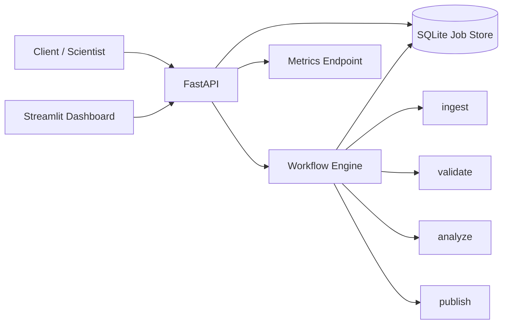

# Scientific Workflow Control Plane

[](https://github.com/ylc22/scientific-workflow-control-plane/actions/workflows/ci.yml)

A production-style demo for orchestrating scientific compute jobs with a clean API, retries, persistence, observability, and an operator dashboard.

This project is intentionally not another model-training notebook. It demonstrates the engineering layer around scientific workloads: how jobs are submitted, tracked, retried, audited, and surfaced to users.

## Why this project

Scientific and bioinformatics teams often have strong analysis code but weak operational tooling around it. A platform engineer or forward deployed engineer usually has to bridge that gap: turn workflows into reliable services, expose usable interfaces, add visibility, and make failures recoverable.

This repo models that problem with synthetic workflows so it can be run locally without private data or cloud credentials.

## What it demonstrates

- FastAPI service for job submission and status
- SQLite-backed persistent job state
- idempotency keys for safe repeated submissions
- retry handling for failed jobs
- structured event history for each job
- lightweight operational metrics
- Streamlit operator dashboard
- deterministic synthetic scientific workloads
- unit and API tests
- Docker support
- GitHub Actions CI

## Architecture



## API surface

| Method | Endpoint | Purpose |
|---|---|---|
| `GET` | `/health` | service health |
| `POST` | `/jobs` | submit a workflow job |
| `GET` | `/jobs` | list recent jobs |
| `GET` | `/jobs/{job_id}` | inspect one job and its event history |
| `POST` | `/jobs/{job_id}/retry` | retry a failed job |
| `GET` | `/metrics` | operational counters |

## Quickstart

```bash
python -m venv .venv
source .venv/bin/activate
# Windows PowerShell: .\.venv\Scripts\Activate.ps1
pip install -r requirements.txt
uvicorn app.main:app --reload
```

Open API docs at `http://127.0.0.1:8000/docs`.

In a second terminal:

```bash
streamlit run app/dashboard.py
```

## Submit a job

```bash
curl -X POST http://127.0.0.1:8000/jobs \
  -H 'Content-Type: application/json' \
  -H 'Idempotency-Key: demo-001' \
  -d '{
    "workflow": "rna-seq-qc",
    "sample_id": "SAMPLE_001",
    "parameters": {"min_reads": 1000000},
    "fail_step": null
  }'
```

To deliberately exercise the retry path, submit a job with `"fail_step": "analyze"`.

## Reliability choices

### Idempotency

Clients can submit an `Idempotency-Key`. Repeating the same request with the same key returns the original job instead of creating duplicates.

### Retry behavior

Failed jobs can be retried through the API. The retry creates a new attempt while preserving the original event history for auditability.

### Persistence

Jobs and events are stored in SQLite, so state survives process restarts. The storage layer is intentionally small and replaceable.

### Observability

The `/metrics` endpoint reports job counts by state plus aggregate retry and submission counters. The dashboard gives an operator-friendly view without requiring a full monitoring stack.

## Repository layout

```text
app/
  main.py          FastAPI application
  models.py        API contracts
  store.py         SQLite persistence
  engine.py        deterministic workflow execution
  metrics.py       lightweight counters
  dashboard.py     Streamlit operator UI
tests/
  test_api.py      API and idempotency coverage
  test_engine.py   workflow-state coverage
.github/workflows/
  ci.yml           automated test workflow
Dockerfile
requirements.txt
```

## Run tests

```bash
python -m pytest -q
```

## Docker

```bash
docker build -t scientific-control-plane .
docker run --rm -p 8000:8000 scientific-control-plane
```

## What I would add in a production version

- real queue / worker separation using SQS, Redis, or a workflow engine
- Postgres instead of SQLite
- authentication and role-based access
- OpenTelemetry traces
- Prometheus metrics
- cloud object storage for artifacts
- Nextflow or nf-core execution adapters
- webhook callbacks
- cancellation and timeouts
- per-tenant quotas
- deployment manifests for Kubernetes

## Recruiter TL;DR

This is a small reference implementation of the engineering work around scientific compute: turning workflows into a reliable product surface with APIs, persistence, failure handling, metrics, and an operator experience.

## License

MIT
